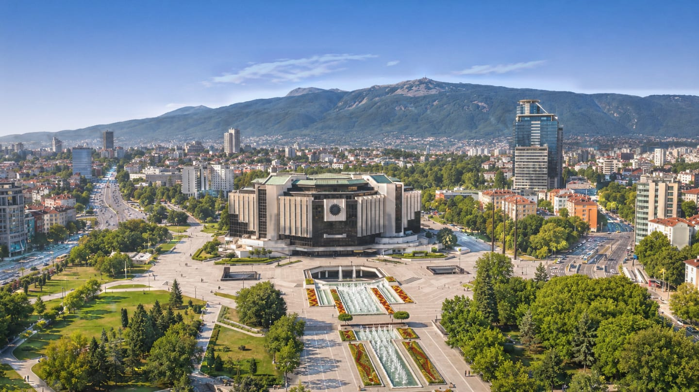
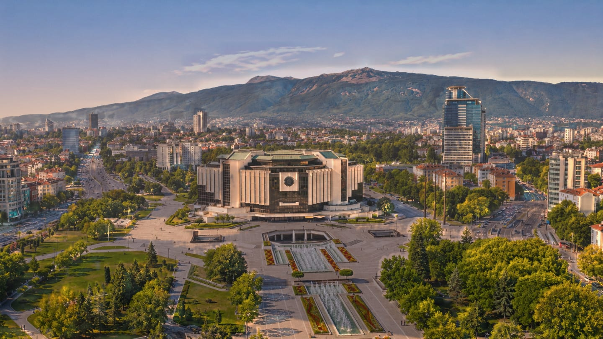
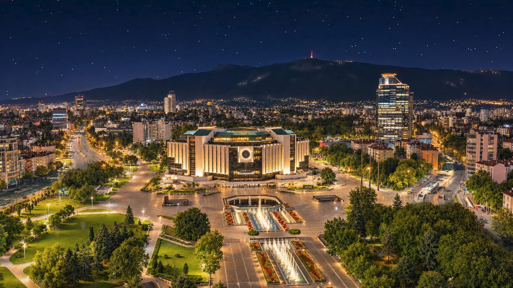
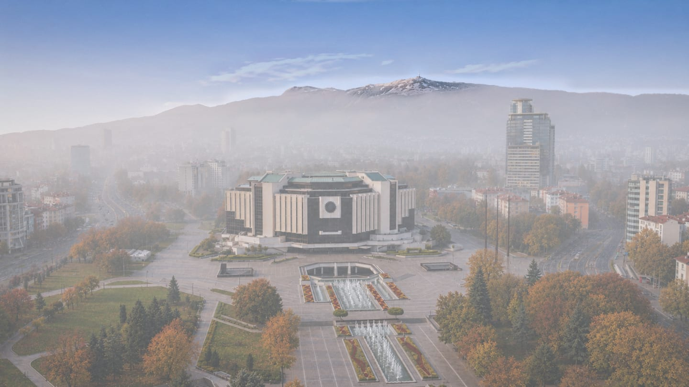
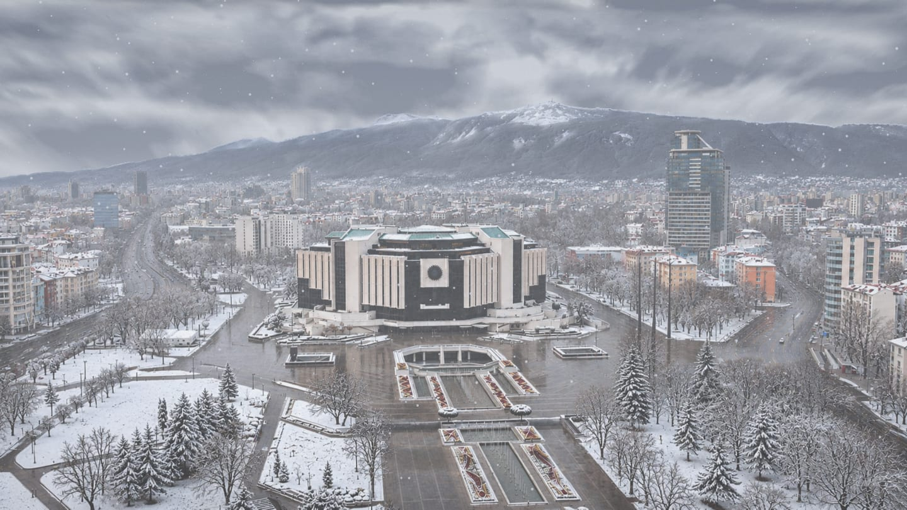
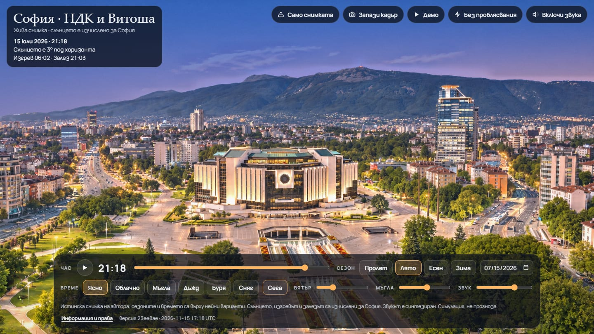

# България през годината · Bulgaria through the year

**Жива снимка на София: НДК и Витоша.** Една истинска снимка, която се променя непрекъснато според часа на деня, сезона, времето и вятъра. Слънцето е изчислено реално за София (алгоритъм на NOAA), трафикът е от самата снимка (колите са изрязани от фотографията и карат само по асфалта), фонтаните, лампите, птиците и листата живеят, а звукът е синтезиран в браузъра. Бутонът „Сега“ слага реалния час и времето в София от Open-Meteo. Статичен сайт, без сървър, без ключове, без разходи. Интерфейсът е на български. Снимките са с всички права запазени, кодът е MIT: виж [Licence](#licence).

---

**Bulgaria through the year** is a *living photograph* of Sofia: the National Palace of Culture (NDK) with Vitosha mountain behind it. It is one real photograph that changes continuously with the time of day, the season, the weather and the wind, rendered in the browser with WebGL2. Everything is static: no backend, no API key, no running cost.

| | |
|---|---|
|  |  |
|  |  |
|  |  |

## What it does

- **Time of day**: dawn, morning, noon, afternoon, golden hour, blue hour, night. The sun position, sunrise and sunset are computed for Sofia (42.6977 N, 23.3219 E, Europe/Sofia with daylight saving), never hardcoded. The camera looks south: morning light comes from the left, evening light from the right.
- **Seasons** blend continuously through the year. Spring is computed from the summer photograph; autumn and winter come from their own photographs.
- **Weather**: clear, cloudy, fog, rain, thunderstorm with lightning, snow, plus wind and fog sliders. Fog is a layer with a height (Vitosha rises above it); snow settles over time and melts.
- **"Сега" (Now)** sets the real current time in Sofia and the live weather from [Open-Meteo](https://open-meteo.com). If the request fails or is blocked, the time is still set and the page says so.
- **Life**: traffic with headlights and taillights, planes with contrails (lights at night), birds (none in winter), fireflies and midges in warm months, autumn leaves, fountains (off in winter), lamps and windows that switch on at dusk.
- **Sound** is fully synthesised with Web Audio (rain, wind, thunder delayed 2.9 s per km, city hum, fountains, crickets, birds, a distant plane) and is **off** until you press the sound button.
- **Accessibility**: `prefers-reduced-motion` is respected; a visible "Без проблясвания" toggle removes lightning flashes (one pulse at most, at least 1.4 s apart, within WCAG 2.3.1); every control is keyboard-operable with a visible focus. `H` hides the interface (photo mode), the camera button saves the current frame as PNG.

## Run it

Node 20.19 or newer.

```bash
npm install
npm run dev          # http://localhost:8080
npm run build        # static site in dist/
npm run preview      # serves dist/ on http://localhost:8080
npm test             # 25 unit tests
```

URL parameters for testing: `?date=2026-07-15&h=20.4&w=rain` (`w`: clear, cloudy, fog, rain, storm, snow), `&wind=0.6`, `&fog=0.8`, `&ui=0` (hide interface), `&still=1` (no parallax/zoom, for exact framing).

The build needs nothing but this repository: the processed web assets are committed in `public/scenes/ndk/`. The original photographs and the data-preparation inputs are **not** part of the repository (see below).

## How the scene is built

A *scene* is a folder: `scene.json` + photographs + masks + depth + geometry. The engine knows nothing about the NDK; a new scene is a new folder under `public/scenes/` (`?scene=<id>`).

1. **Photographs.** One summer-day photograph plus AI-made variants of the *same composition* (autumn, winter day, summer night, rain night, fog, dawn blue hour, dawn golden hour, winter night). Every variant is checked against the master with phase correlation and six anchor points (sub-pixel to 0.9 px); AI artifacts that must stay live are removed (baked light trails, baked cars).
2. **Depth and normals.** [Depth Anything V2 Small](https://github.com/DepthAnything/Depth-Anything-V2), calibrated against the ground plane so depth is linear in image rows. That gives 3D positions, surface normals, cast shadows, parallax and the height of fog.
3. **Masks.** Sky (traced as a seam through edges that agree across variants), mountain, vegetation, water, paved ground, buildings, roads, glass. Vitosha keeps the *original's* texture and takes only colour and snow cover from a variant, so the mountain never looks painted.
4. **WebGL2 compositor** (three passes). Shadow ray-march through the depth map; a base pass that blends the variants in linear light and relights the day photograph for the real sun, sky, cloud cover and weather; a composite pass with parallax, wind, water, wet ground, photographic cloud layers, fog, grade and grain.
5. **Sun.** NOAA solar position (Meeus), Europe/Sofia daylight saving, sunrise and sunset by numerical search. Checked against Open-Meteo on five dates (including both DST switch days): at most 1.33 minutes apart.
6. **Traffic from the photograph.** Carriageways are traced from the photo; baked cars are detected, cut out as sprites and inpainted out of an *empty road plate*; live cars drive in metres along lanes inside a strict asphalt mask (car-following model, signal queue, spawn only at declared ends), are composited **before** relighting so they share the photograph's light, haze and grain, and the build fails if a lane leaves the asphalt. Details: [docs/TRAFFIC.md](docs/TRAFFIC.md).

Missing optional variants are computed from the others and picked up automatically if the files appear later: `evening-golden.png`, `evening-bluehour.png` (light from the right) and `spring.png`.

## Folder structure

```
src/
  engine/    sun (NOAA), state, blending, scene loading, clock, adaptive quality
  render/    WebGL2: compositor, shaders, sprites, traffic layer
  weather/   rain, snow, lightning, Open-Meteo
  life/      traffic, lamps, fountains, planes, birds, insects, leaves
  audio/     synthesised sound
  ui/        interface (Bulgarian), demo loop, dev-only debug overlay
public/
  scenes/ndk/   processed photographs (AVIF + WebP), masks, depth, traffic data, scene.json
tools/       data preparation (Node + sharp; depth in Python), not run by the build
tests/       unit/ (node --test) and qa/ (Playwright)
docs/        ARCHITECTURE, TRAFFIC, QA, ALIGNMENT, ASSUMPTIONS, PROGRESS, screenshots
vercel.json  cache headers for the static host
```

Preparing the assets from the original photographs (not needed to build or run the site) is described in [docs/README.md](docs/README.md) (in Bulgarian); the architecture in [docs/ARCHITECTURE.md](docs/ARCHITECTURE.md).

## Known limits

- **WebGL 2 is required.** Tested in Chromium on Windows with a real GPU (60 fps at 1080p, heaviest states included). **Not tested** in Safari or Firefox, on a real phone (gyroscope parallax, bottom sheet, 30 fps target), or on integrated GPUs; adaptive quality is in place but unmeasured there.
- **The sound has been checked mechanically, not listened to by a person.**
- **Live traffic runs on the left avenue only.** The right avenue and the small streets stay as photographed (deep shadow, junctions, parked cars). During sunrise (golden-hour photograph) and on winter days the carriageways are closed to new cars, because those AI variants redrew the road or their cars are too small for the detector. Winter nights and all other states have live traffic.
- The seasonal and time-of-day photographs are **AI-made variants**, so tiny details (windows, trees) differ between states; spring and evening are computed, not photographed.
- Shadows come from monocular depth and are approximate.
- Open-Meteo's free API is for **non-commercial** use; a commercial deployment needs their paid plan.
- It is a simulation, not a forecast.

## Credits

- **Photograph** of the NDK and Vitosha: the author of this project.
- **[Depth Anything V2](https://github.com/DepthAnything/Depth-Anything-V2)** (Small model, Apache-2.0), Lihe Yang et al., NeurIPS 2024: depth maps used while preparing the images.
- **Weather data by [Open-Meteo.com](https://open-meteo.com)**, licensed [CC BY 4.0](https://creativecommons.org/licenses/by/4.0/).
- **Solar position**: NOAA Solar Calculator equations, after Jean Meeus, *Astronomical Algorithms*.
- **[Manrope](https://github.com/sharanda/manrope)** font by The Manrope Project Authors, SIL Open Font License 1.1 (served with the site; text in [public/THIRD-PARTY-LICENSES.txt](public/THIRD-PARTY-LICENSES.txt)).
- Build and test tooling, not shipped to visitors: [Vite](https://vite.dev) (MIT), [Playwright](https://playwright.dev) (Apache-2.0), [sharp](https://sharp.pixelplumbing.com) (Apache-2.0, libvips LGPL-3.0).

The app footer has an "Информация и права" button that shows the same credits.

## Licence

- **Source code: MIT.**
- **Photographs and every image derived from them: all rights reserved**: `public/scenes/**` (variants, masks, depth, normals, car sprites, geometry), the social card, the icons and the screenshots in `docs/`. You may view the site and read or run the code; you may not reuse the pictures.

The full text is in [LICENSE](LICENSE).
